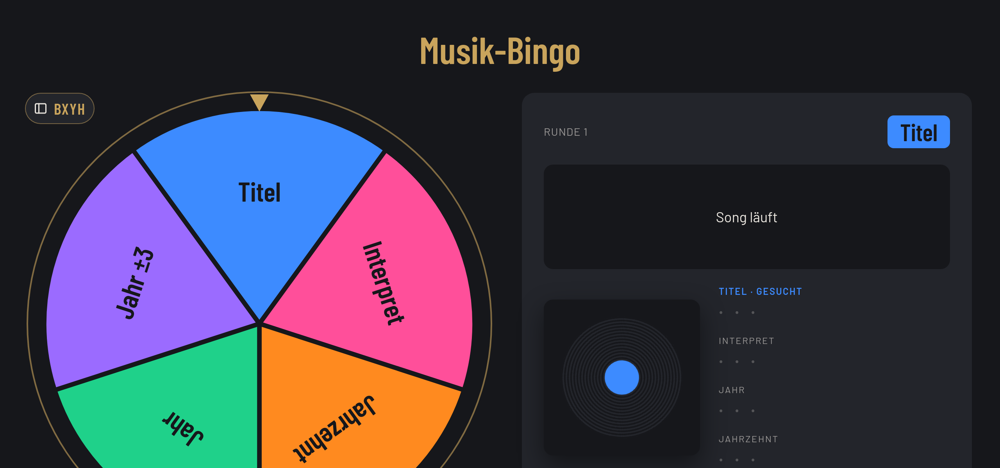

# Musik-Bingo

Musik-Bingo als Web-App für Spieleabende mit Freunden: Ein Rad wählt die Kategorie, ein Song aus einer eigenen
Spotify-Playlist läuft, und wer richtig liegt, hakt ein Feld seiner 5×5-Karte ab.

**Live:** https://musik-bingo.vercel.app („Demo starten“ zeigt das Spiel ohne Spotify-Konto)



## Wie gespielt wird

Der Laptop ist der Tisch, an dem der DJ das Rad dreht. Die Spieler treten mit Raum-Code oder QR-Code bei und haben Karte
und Notizfläche auf dem eigenen Handy.

1. Das Rad wählt eine Kategorie: Titel, Interpret, Jahrzehnt, Erscheinungsjahr oder Jahr ±3.
2. Ein Song aus der Playlist des DJs läuft, als Ausschnitt oder ganz.
3. Die Auflösung zeigt die Lösung, wer richtig lag, hakt ein Feld in der Farbe der Kategorie ab.
4. Wer eine Zeile, Spalte oder Diagonale voll hat, hat Bingo.

Im Online-Modus spielt jeder am eigenen PC, und der DJ überträgt den Ton per WebRTC direkt an alle Mitspieler.

## Technik

| Bereich | Umsetzung |
|---|---|
| Oberfläche | Next.js mit React und TypeScript, Tailwind CSS |
| Echtzeit | Supabase Realtime: Broadcast für den Spielstand, Presence für die Anwesenheit, keine Tabellen |
| Musik | Spotify Web API und Web Playback SDK, Erscheinungsjahr aus MusicBrainz |
| Ton im Online-Modus | WebRTC, das Signaling läuft über den Raum-Kanal |
| Hosting | Vercel, mit einer Vorschau je Pull Request |
| Tests | Vitest für Spiellogik und Ansichten, Playwright mit Bots als Tisch und Spieler im Browser |
| Qualität | ESLint, Prettier, Typprüfung, CI mit GitHub Actions bei jedem Pull Request |

## Entscheidungen

- **Nur der DJ meldet sich bei Spotify an:** Eine private Spotify-App erlaubt höchstens fünf freigeschaltete Konten.
  Mitspieler brauchen deshalb kein Konto. Die Anmeldung läuft mit PKCE nur im Browser, ohne Client-Secret.
- **Spiellogik als reine Funktionen:** Rad, Karte, Songauswahl und Bingo-Erkennung hängen weder an React noch an
  Spotify oder Supabase und sind testgetrieben entstanden (`lib/`).
- **Das Erscheinungsjahr kommt aus MusicBrainz:** Spotify liefert das Jahr des Albums, bei Remastern und Best-ofs oft
  falsch. Der DJ kann es in der Auflösung korrigieren.
- **Spielstand über Broadcast:** Der erste Ansatz über Presence scheiterte beim Test mit echten Handys am Limit von
  Supabase (5 Änderungen in 30 Sekunden). Ein WebSocket-Mitschnitt zeigte die Ursache, ADR 0006 beschreibt den Umbau.

Begründungen und verworfene Alternativen stehen als ADRs (Architecture Decision Records) in [`docs/adr/`](docs/adr/).

## Lokal starten

```bash
npm ci                       # Abhängigkeiten installieren
cp .env.example .env.local   # Spotify-Client-ID und Supabase-Zugang eintragen, ohne sie läuft nur die Demo
npm run dev                  # App starten unter http://127.0.0.1:3000
npm run check                # Linter, Formatprüfung, Typprüfung und Tests
```

## Stand

Spielbar am Tisch mit Handys und online mit Ton vom DJ. Geplant sind ein Scoreboard über einen ganzen Spieleabend,
weitere Kategorien und der Tisch ganz am Handy. Die Roadmap steht in [`docs/Projektvision.md`](docs/Projektvision.md).

## Wie es entsteht

Das Projekt ist ein Lernprojekt. Ich entwickle es mit Claude Code als KI-Werkzeug: Plan, Entscheidungen und Prüfung liegen
bei mir, Tests und CI prüfen jede Änderung. Pläne, Lernjournale und Notizen liegen in [`docs/`](docs/).
